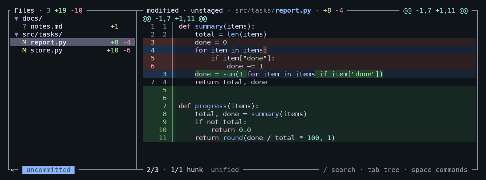

Title: dffy: a diff viewer for the terminal
Date: 2026-11-17 23:10
Category: Herramientas
Tags: git, dffy, cli, rust, diff
Slug: dffy-visor-diffs-terminal
Lang: en
featured_image: /images/dffy.png
Summary: dffy is a terminal diff viewer written in Rust. File tree, search, syntax-aware diffs and an engine that opens the Linux kernel's 13,168 changed files in under 10 ms. It has replaced delta as my git pager.

I've changed diff programs. I'd been using [delta](https://github.com/dandavison/delta) as my git pager for years, and for a loose diff it's perfect, but it isn't a viewer: it's a colouriser. When the change spans thirty files and I want to get to the one that matters, delta gives me no tree, no search, no way to jump between files. That's what I was missing.

That something is [dffy](https://github.com/amalucelli/dffy), a terminal diff viewer written in Rust. I run it inside the repo and it opens the change full screen: file tree on the left, diff on the right, split or unified. Pipe something into it and it prints the diff like any pager.



## What it is

A native binary, no runtime behind it, doing three things at once: interactive viewer, git pager and diff generator for scripts. It has its own diff engine (histogram plus a syntax one) and its own terminal renderer, with no TUI framework in between.

What made me switch:

- **Incremental start**. It doesn't compute the whole diff before painting: it shows the first files as soon as it finds them and keeps working on the rest in the background. The Linux kernel's `v6.0..v6.1` range is 13,168 files and a 48 MB patch, and the first changed line is on screen in under 10 ms. With `--watch` it repaints as you edit, stage and commit.
- **Real navigation**. File tree, fuzzy picker on `o`, search across the whole diff with `/`, `v` in the tree to mark files as viewed. Each file opens at its first change, and `n`/`N` jump change to change, crossing into the next file when needed.
- **Syntax-aware diff**. `d` swaps the engine: it emphasises only the tokens that actually change (even when they've been reordered), dims code that was only reformatted (`~`) and marks statements or items that moved with `»`. It's what [difftastic](https://github.com/Wilfred/difftastic) does, but inside the same viewer.
- **Staged, unstaged and untracked in one view**, each file tagged with its state. Plus conflicted files from a merge, rebase or cherry-pick, with the conflict markers highlighted.
- **Split or unified picked automatically** from the terminal width, highlighting for 30 languages, and the changed word emphasised inside the line.

## Install

On macOS, as a cask:

```bash
brew install --cask amalucelli/tap/dffy
```

On Linux I used the official script, which drops it in `~/.local/bin/dffy`:

```bash
curl -fsSL https://raw.githubusercontent.com/amalucelli/dffy/main/install.sh | sh
```

I'm on `0.2.1`.

## Usage

```bash
dffy                        # staged, unstaged and untracked
dffy --staged               # what's in the index
dffy HEAD~3                 # a revision against the working tree
dffy main...feature         # changes since the merge base
dffy show HEAD              # a commit with its message
dffy main.. -- src/         # limited to a path
dffy a.txt b.txt            # two files or folders, no repo needed
dffy --watch                # refresh on every change
dffy --syntax v6.0 v6.1     # diff by syntax, not by lines
dffy --stat main..          # also --name-only, --name-status, --exit-code
```

Inside the viewer almost everything is a single key: `n`/`N` between changes, `f`/`F` between files, `/` searches, `o` opens the picker, `s` cycles the layout, `W` wraps long lines, `d` turns on the syntax diff, `space` opens the command panel, `?` lists the keys in effect and `q` quits.

## As git's pager

This is the bit that replaces delta:

```bash
git config --global core.pager dffy
git config --global interactive.diffFilter "dffy --color-only"
```

The `--color-only` matters because it preserves the line count (38 in, 38 out), which is what `git add -p` needs to avoid complaining about "mismatched output". And as a difftool:

```bash
git config --global difftool.dffy.cmd 'dffy "$LOCAL" "$REMOTE"'
git config --global difftool.prompt false
git difftool --tool=dffy -d main    # every file at once, as two folders
```

I also wired it into my `ai-diff` script, which now renders the preview with `dffy --color=always --paging=never`.

## For scripts and agents

Two outputs that have nothing to do with the TUI:

```bash
dffy --json main.. | jq -c 'select(.type == "file") | {path, added, removed}'
```

`--json` emits JSON Lines: a header, one line per file with its hunks and, for every diff line, its kind (`added`, `removed`, `context`), whether it's paired with its edit and the column ranges that were touched. That's what I use when I want an agent to read a diff without swallowing 40 MB of text.

The other one is `dffy mcp`, a [MCP](https://modelcontextprotocol.io) server that lets an agent list a change's files and read its diffs a page at a time, instead of dumping the whole patch into the prompt.

## Configuration

Everything lives in `~/.config/dffy/config`, as `key = value` lines, so it can go in your dotfiles. These are the keys I look at before any other:

```text
view = auto            # auto, split or unified (splits from 140 columns)
theme = tokyo-night    # 15 built-in themes
context = 3            # lines of context (-U)
syntax-diff = false    # off by default; I toggle it with 'd' in the viewer
```

`dffy config --default` lists every key with its value, and `dffy themes` shows the themes with a preview. Bindings are rewritten with `keybind` lines, including separate tables for the tree and the command panel:

```text
keybind = ctrl+d=page_down
keybind = tree:x=mark_viewed
```

## Where it falls short

- **It's a three-day-old project**. The first public release is from 14 November, it's on 0.2.1 and it has 23 stars. That means config and flags can change without notice. I made it my pager anyway: if it breaks tomorrow, I'm back on delta in one command.
- **Git only**. No Jujutsu, Mercurial or Sapling, which [hunk](https://hunk.dev) and [lumen](https://github.com/jnsahaj/lumen) do support. If you live in `jj`, this isn't for you.
- **No AI annotations**. [Lumen](https://github.com/jnsahaj/lumen) and [hunk](https://hunk.dev) have an assistant layer on top of the diff; there's none of that here. The MCP server makes up for it, and that's the part I care about.
- **Renderer plugins are experimental**: Markdown and Mermaid rendered inside the viewer, on `r`. It works, but it's clearly early.

The summary: delta decorates a diff, dffy reviews it. For a two-line patch I don't care which one I use, but for the 90% of diffs I actually read, I want the tree and the keys.

*Original source*: [amalucelli/dffy](https://github.com/amalucelli/dffy)
