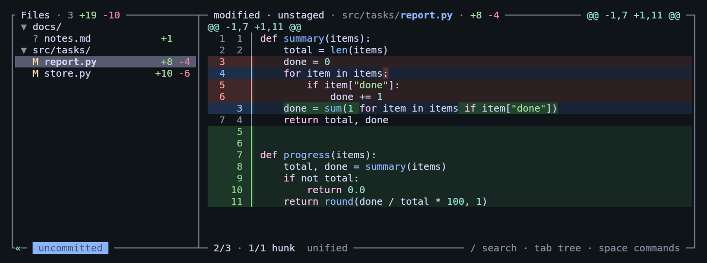

Title: dffy: un visor de diffs para la terminal
Date: 2026-11-17 23:10
Category: Herramientas
Tags: git, dffy, cli, rust, diff
Slug: dffy-visor-diffs-terminal
Lang: es
featured_image: /images/dffy.png
Summary: dffy es un visor de diffs de terminal escrito en Rust. Árbol de ficheros, búsqueda, diff por sintaxis y un motor que abre los 13.168 ficheros del kernel de Linux en menos de 10 ms. Ha sustituido a delta como pager de git.

He cambiado el programa de diffs. Venía usando [delta](https://github.com/dandavison/delta) como pager de git desde hace años y para un diff suelto está perfecto, pero no es un visor: es un coloreador. Cuando el cambio tiene treinta ficheros y quiero ir al que me interesa, delta no me da ni un árbol, ni búsqueda, ni forma de saltar entre ficheros. Ahí me faltaba algo.

Ese algo es [dffy](https://github.com/amalucelli/dffy), un visor de diffs de terminal escrito en Rust. Lo lanzo dentro del repo y abre el cambio a pantalla completa: árbol de ficheros a la izquierda, diff a la derecha, split o unified. Si lo meto en un pipe, imprime el diff como cualquier pager.



## Qué es

Un binario nativo, sin runtime detrás, que hace tres cosas a la vez: visor interactivo, pager de git y generador de diffs para scripts. El motor de diff es suyo (histogram y uno por sintaxis), el renderer de terminal también, sin framework TUI de por medio.

Lo que me hizo cambiar de herramienta:

- **Arranque incremental**. No calcula el diff entero antes de pintar: enseña los primeros ficheros en cuanto los encuentra y sigue trabajando en el resto por detrás. El rango `v6.0..v6.1` del kernel de Linux son 13.168 ficheros y un parche de 48 MB, y la primera línea cambiada aparece en menos de 10 ms. Con `--watch` repinta solo al editar, hacer stage o commitear.
- **Navegación de verdad**. Árbol de ficheros, picker difuso con `o`, búsqueda en todo el diff con `/`, `v` en el árbol para marcar ficheros como vistos. Cada fichero se abre en su primer cambio y `n`/`N` saltan de cambio en cambio, cruzando de fichero cuando toca.
- **Diff por sintaxis**. Con `d` cambia el motor: resalta solo los tokens que cambian de verdad (aunque hayan cambiado de orden), atenúa el código que solo se ha reformateado (`~`) y marca con `»` las sentencias o items que se han movido de sitio. Es lo que hace [difftastic](https://github.com/Wilfred/difftastic), pero dentro del mismo visor.
- **Staged, unstaged y untracked en una sola vista**, cada fichero marcado con su estado. Y los ficheros en conflicto de un merge, rebase o cherry-pick, con los marcadores resaltados.
- **Split o unified automático** según el ancho del terminal, resaltado de 30 lenguajes y énfasis en la palabra que cambió dentro de la línea.

## Instalación

En macOS, por cask:

```bash
brew install --cask amalucelli/tap/dffy
```

En Linux lo instalé con el script oficial, que lo deja en `~/.local/bin/dffy`:

```bash
curl -fsSL https://raw.githubusercontent.com/amalucelli/dffy/main/install.sh | sh
```

La versión que tengo es la `0.2.1`.

## Uso

```bash
dffy                        # staged, unstaged y untracked
dffy --staged               # lo que está en el índice
dffy HEAD~3                 # una revisión contra el árbol de trabajo
dffy main...feature         # cambios desde el merge base
dffy show HEAD              # un commit con su mensaje
dffy main.. -- src/         # limitado a una ruta
dffy a.txt b.txt            # dos ficheros o carpetas, sin repo
dffy --watch                # refresca con cada cambio
dffy --syntax v6.0 v6.1     # compara por sintaxis, no por líneas
dffy --stat main..          # también --name-only, --name-status, --exit-code
```

Dentro del visor, casi todo es una tecla sola: `n`/`N` entre cambios, `f`/`F` entre ficheros, `/` busca, `o` abre el picker, `s` cambia el layout, `W` ajusta líneas largas, `d` activa el diff por sintaxis, `space` abre el panel de comandos, `?` lista los atajos vigentes y `q` sale.

## Como pager de git

Es lo que sustituye a delta:

```bash
git config --global core.pager dffy
git config --global interactive.diffFilter "dffy --color-only"
```

El `--color-only` es importante porque preserva el número de líneas (38 entran, 38 salen), que es lo que `git add -p` necesita para no quejarse de "mismatched output". Y como difftool:

```bash
git config --global difftool.dffy.cmd 'dffy "$LOCAL" "$REMOTE"'
git config --global difftool.prompt false
git difftool --tool=dffy -d main    # todos los ficheros a la vez, como dos carpetas
```

También lo he metido en mi script `ai-diff`, que ahora renderiza el preview con `dffy --color=always --paging=never`.

## Para scripts y agentes

Dos salidas que no tienen nada que ver con la TUI:

```bash
dffy --json main.. | jq -c 'select(.type == "file") | {path, added, removed}'
```

`--json` escupe JSON Lines: una cabecera, una línea por fichero con sus hunks y, por cada línea del diff, su tipo (`added`, `removed`, `context`), si está emparejada con su edición y los rangos de columnas que se han tocado. Es lo que uso cuando quiero que un agente lea un diff sin comerse 40 MB de texto.

El otro es `dffy mcp`, un servidor [MCP](https://modelcontextprotocol.io) que deja a un agente listar los ficheros de un cambio y leer los diffs página a página, en lugar de volcarle el parche entero en el prompt.

## Configuración

Todo vive en `~/.config/dffy/config`, en líneas `clave = valor`, así que se puede versionar con los dotfiles. Estas son las claves que miro antes que ninguna otra:

```text
view = auto            # auto, split o unified (split a partir de 140 columnas)
theme = tokyo-night    # 15 temas de serie
context = 3            # líneas de contexto (-U)
syntax-diff = false    # diff por sintaxis de serie; lo activo con 'd' en el visor
```

`dffy config --default` lista todas las claves con su valor, y `dffy themes` enseña los temas con una previsualización. Los atajos se reescriben con líneas `keybind`, incluyendo tablas distintas para el árbol y para el panel de comandos:

```text
keybind = ctrl+d=page_down
keybind = tree:x=mark_viewed
```

## Donde flojea

- **Es un proyecto de tres días**. La primera versión pública es del 14 de noviembre, va por la 0.2.1 y tiene 23 estrellas. Eso significa que la configuración y los flags pueden cambiar sin avisar. Aun así lo he puesto como pager: si mañana se rompe, vuelvo a delta en un comando.
- **Solo git**. Nada de Jujutsu, Mercurial ni Sapling, que sí soportan [hunk](https://hunk.dev) y [lumen](https://github.com/jnsahaj/lumen). Si trabajas con `jj` a diario, esto no te sirve.
- **Sin anotaciones de IA**. [Lumen](https://github.com/jnsahaj/lumen) y [hunk](https://hunk.dev) tienen su capa de asistente encima del diff; aquí no hay nada de eso. Compensa con el servidor MCP, que es la parte que a mí me interesa.
- **Los plugins de render son experimentales**: Markdown y Mermaid renderizados dentro del visor, con `r`. Funciona, pero se nota que está verde.

El resumen: delta decora un diff, dffy lo revisa. Para un parche de dos líneas me da igual el uno que el otro, pero para el 90% de los diffs que miro de verdad, quiero el árbol y las teclas.

*Fuente original*: [amalucelli/dffy](https://github.com/amalucelli/dffy)
