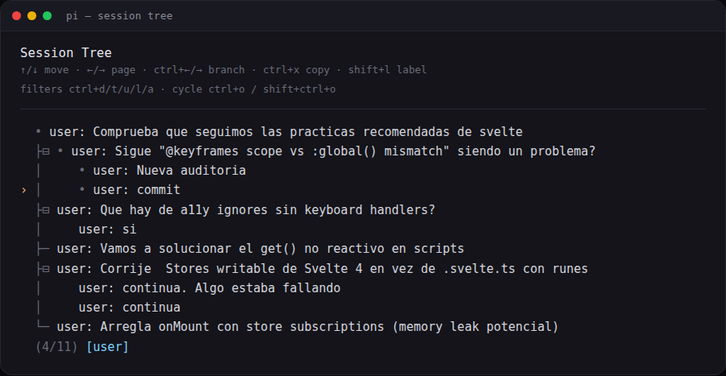
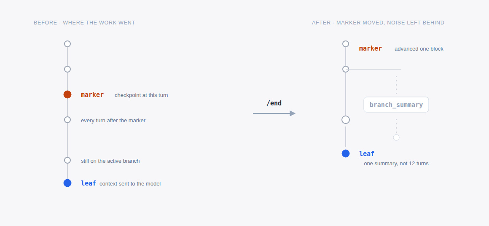

Fourth part of the series on [pi](https://pi.dev/). In the [second part](https://pablocaro.es/en/pi-de-principiante-a-avanzado) `/tree` was just another bullet in a list of commands. This is what sits under the session tree and how I use it: branching inside the same file, when to move work out to a new session, and the marker plus `/end` loop I close work blocks with so I don't drag noise along.



## A session is a file with a tree inside

No database, no index. Each session is a JSONL file under `~/.pi/agent/sessions/`, grouped by working directory:

```text
~/.pi/agent/sessions/--home-pcaro-src-anotaciones--/<id>.jsonl
```

The first line is the header, with `version`, `id`, `timestamp` and `cwd`. From there on, every line is an entry with its own `id` and a `parentId` pointing at the previous one. That is the whole tree.

```json
{
  "type": "branch_summary",
  "id": "62224c4f",
  "parentId": "8e2ca4f2",
  "fromId": "8e2ca4f2",
  "timestamp": "2026-06-11T17:00:15.313Z",
  "summary": "The user explored a different conversation branch..."
}
```

The detail that matters: **the model only gets the active branch**, rebuilt from the last message (the `leaf`) back to the root. Branches you walk away from are not deleted, they stay in the file and cost no context.

```text
[user] ─ [assistant] ─┬─ [user]                 ← leaf: active branch
                      │
                      └─ [branch_summary] ─ [user]   ← alternate branch
```

## /tree: branch without leaving the file

`/tree` opens the navigator. It had no keyboard shortcut by default, so I gave it one in `~/.pi/agent/keybindings.json`:

```json
{ "app.session.tree": "alt+shift+e" }
```

The flow: you select a user message and its text goes back into the editor. Edit it, send it, and that creates a new branch at that same point. If you select an assistant response instead, it continues from there with an empty editor.

On long sessions the navigator fills up, so the filters are half the value:

- `ctrl+t` — hide tool results
- `ctrl+u` — only my messages
- `ctrl+l` — only labelled entries
- `ctrl+a` — everything
- `ctrl+o` / `shift+ctrl+o` — cycle filters

And to find your way around: `shift+l` labels the selected entry, `shift+t` toggles its timestamps, `alt+←/→` (or `ctrl+←/→`) folds a branch segment or jumps to the next one.

When I use it: to compare two implementations from the same starting point, and when the agent has wandered off and I'd rather go back to the message where I lost it than rebuild context in a clean session. The failed attempt stays there and I can return to it.

## /fork and /clone: when the alternative is other work

- **`/fork`** — a new session from an earlier user message.
- **`/clone`** — copies the whole active branch into a new session.

Both write a new file with `parentSessionId` pointing at the original. From the CLI there is `pi --fork <path|id>`, which cannot be combined with `--session`, `--continue`, `--resume` or `--no-session`.

The rule I apply: if the alternative is **another variant of the same work**, I stay inside the file with `/tree`. If it is **other work** that will live for days, it gets its own session with `/fork`. Mixing two different tasks into one tree ends up with a navigator nobody can read.

My numbers show the pattern: out of roughly 1400 sessions, 155 carry a `parentSession` and only 6 have a `branch_summary`. I barely use the native tree, because day-to-day work goes through something else.

## Walking away from a branch without losing it

When you leave a branch, pi offers to summarize it and attach that summary to the branch you enter. It gets stored as a `branch_summary` with two references: `parentId` (the point you continue from) and `fromId` (the last message of the branch you leave).

The text is generated by the model with the same template it uses for compaction: Goal, Constraints & Preferences, Progress, Key Decisions, Next Steps, plus the list of touched files when relevant. And it always starts the same way:

```text
The user explored a different conversation branch before returning here.
Summary of that exploration:

## Goal
Fix memory leaks caused by store subscriptions with onMount
and no cleanup
...
```

That summary is why `/tree` is not just navigation: the work from the abandoned branch reaches the new one as useful context, without dragging the hundreds of messages that produced it.

## What I do every day: marker and /end

This is 90% of my tree usage, and it is the part that does not ship with pi. With the [pi-auto-trees](https://github.com/IgorWarzocha/howaboua-pi-stuff/tree/main/packages/pi-auto-trees) extension the tree stops being something I touch by hand:

- **`/prime [scope]`** — an orientation turn over a repo or folder, with an automatic marker afterwards.
- **`/marker`** — a checkpoint at the current point, without an agent turn.
- **`/end`** — summarizes what happened since the marker, navigates back to that point carrying the summary, and moves the marker forward.

There are variants I pick depending on the moment: `/end git` adds the commit that should be made, and `/end <instruction>` gives the summary a focus (say `/end focus on API changes`).

The config is a separate file, `~/.pi/agent/pi-auto-trees.json`:

```json
{
  "summary": {
    "enabled": true,
    "model": "opencode-go/gpt-5.6-luna",
    "thinking": "low"
  }
}
```

A lightweight model used only for summaries; if it is unavailable, pi tells you and falls back to the session model.



Markers live in the session branch, so navigating back to an earlier point restores them, and what gets persisted are ordinary `label` entries: you see them in `/tree` with the `ctrl+l` filter.

That is why I almost never open `/tree`: every `/end` takes me back to the starting point, carries the implementation noise away and leaves a labelled checkpoint behind. The tree stops being a graveyard of attempts and becomes the index of the work.

## Before you go

The tree is not there to pile up attempts, it is there so you don't pay for the same context twice. If a branch won't be useful even summarized, don't open it.

In the [third part](https://pablocaro.es/en/extensiones-pi-que-uso) I go through the rest of the extensions I use daily. And if you are starting from zero, the [first part](https://pablocaro.es/en/que-es-pi-coding-agent) explains what pi is and how it differs from everything else.

*Source*: [pi documentation](https://github.com/earendil-works/pi/tree/main/packages/coding-agent/docs) — sessions, session format and compaction.
