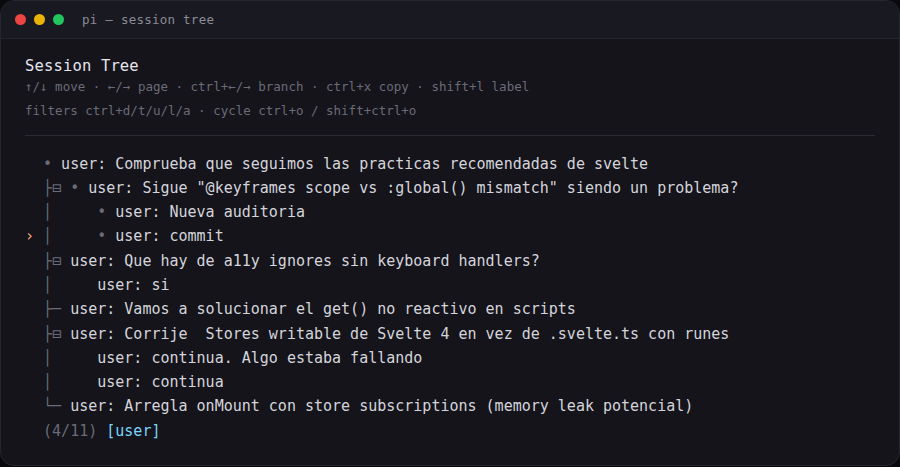
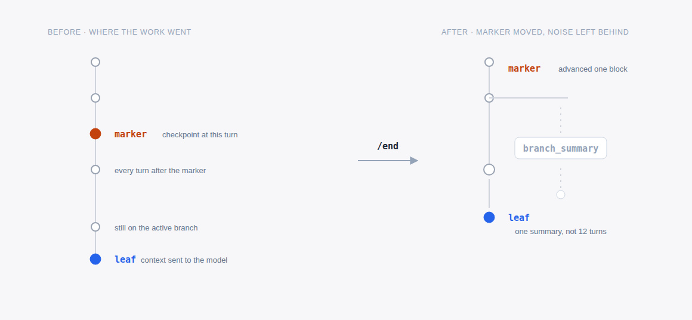

Cuarta entrega de la serie sobre [pi](https://pi.dev/). En la [segunda parte](https://pablocaro.es/pi-de-principiante-a-avanzado) `/tree` salió como un bullet más en una lista de comandos. Esto es lo que hay debajo del árbol de sesiones y cómo lo uso: ramificar dentro del mismo fichero, cuándo salir a una sesión nueva, y el ciclo de marker y `/end` con el que cierro bloques de trabajo sin arrastrar ruido.



## Una sesión es un fichero con un árbol dentro

Nada de base de datos ni índices. Cada sesión es un JSONL en `~/.pi/agent/sessions/`, agrupado por directorio de trabajo:

```text
~/.pi/agent/sessions/--home-pcaro-src-anotaciones--/<id>.jsonl
```

La primera línea es la cabecera, con `version`, `id`, `timestamp` y `cwd`. A partir de ahí, cada línea es una entrada con su propio `id` y un `parentId` que apunta a la anterior. Eso es el árbol entero.

```json
{
  "type": "branch_summary",
  "id": "62224c4f",
  "parentId": "8e2ca4f2",
  "fromId": "8e2ca4f2",
  "timestamp": "2026-06-11T17:00:15.313Z",
  "summary": "The user explored a different conversation branch..."
}
```

El detalle que importa: **el modelo solo recibe la rama activa**, reconstruida desde el último mensaje (`leaf`) hacia atrás. Las ramas que abandonas no se borran, se quedan en el fichero y no cuestan contexto.

```text
[user] ─ [assistant] ─┬─ [user]                 ← leaf: rama activa
                      │
                      └─ [branch_summary] ─ [user]   ← rama alterna
```

## /tree: ramificar sin salir del fichero

`/tree` abre el navegador. No había atajo por defecto, así que me puse uno en `~/.pi/agent/keybindings.json`:

```json
{ "app.session.tree": "alt+shift+e" }
```

El flujo es: seleccionas un mensaje de usuario y su texto vuelve al editor. Lo editas, lo envías, y eso crea una rama nueva en ese mismo punto. Si seleccionas una respuesta del asistente en lugar de un mensaje de usuario, continúa desde ahí con el editor vacío.

Con sesiones largas el navegador se llena, así que los filtros son la mitad de la utilidad:

- `ctrl+t` — oculta resultados de herramientas
- `ctrl+u` — solo mensajes míos
- `ctrl+l` — solo entradas etiquetadas
- `ctrl+a` — todo
- `ctrl+o` / `shift+ctrl+o` — ciclar filtros

Y para orientarse: `shift+l` pone etiqueta a la entrada seleccionada, `shift+t` muestra u oculta sus timestamps, `alt+←/→` (o `ctrl+←/→`) pliega un tramo de rama o salta al siguiente.

Cuándo lo uso: para comparar dos implementaciones desde el mismo punto de partida, y cuando el agente se ha ido por las ramas y prefiero volver al mensaje donde me perdí en vez de reconstruir el contexto en una sesión limpia. El intento fallido sigue ahí y puedo volver a él.

## /fork y /clone: cuando la alternativa es otro trabajo

- **`/fork`** — sesión nueva a partir de un mensaje de usuario anterior.
- **`/clone`** — copia la rama activa entera a una sesión nueva.

Las dos escriben un fichero nuevo con `parentSessionId` apuntando al original. Desde la CLI existe `pi --fork <path|id>`, que no se puede combinar con `--session`, `--continue`, `--resume` ni `--no-session`.

El criterio que aplico: si la alternativa es **otra variante del mismo trabajo**, me quedo dentro del fichero con `/tree`. Si es **otro trabajo** que va a vivir días, sale a sesión propia con `/fork`. Mezclar dos tareas distintas en el mismo árbol termina con un navegador que no hay quien lea.

En mis números se ve el patrón: de unas 1400 sesiones, 155 arrastran `parentSession` y solo 6 tienen `branch_summary`. El árbol nativo lo uso poco, porque el trabajo del día a día va por otro lado.

## Abandonar una rama sin perderla

Cuando sales de una rama, pi ofrece resumirla y colgar ese resumen de la rama a la que entras. Se guarda como `branch_summary` con dos referencias: `parentId` (el punto desde el que continúas) y `fromId` (el último mensaje de la rama que dejas).

El texto lo genera el modelo con la misma plantilla que usa al compactar: Goal, Constraints & Preferences, Progress, Key Decisions, Next Steps, más la lista de ficheros tocados cuando aplica. Y empieza siempre igual:

```text
The user explored a different conversation branch before returning here.
Summary of that exploration:

## Goal
Corregir memory leaks causados por suscripciones a stores
con onMount sin cleanup
...
```

Ese resumen es la razón por la que `/tree` no es solo navegación: el trabajo de la rama abandonada llega a la nueva como contexto útil, sin arrastrar los cientos de mensajes que lo produjeron.

## Lo que hago a diario: marker y /end

Aquí está el 90% de mi uso del árbol, y es la parte que no viene de serie. Con la extensión [pi-auto-trees](https://github.com/IgorWarzocha/howaboua-pi-stuff/tree/main/packages/pi-auto-trees) el árbol deja de ser algo que toco a mano:

- **`/prime [scope]`** — turno de orientación sobre un repo o carpeta, con marker automático al terminar.
- **`/marker`** — checkpoint en el punto actual, sin turno de agente.
- **`/end`** — resume lo hecho desde el marker, vuelve a ese punto arrastrando el resumen y avanza el marker.

Hay variantes que uso según el momento: `/end git` añade el commit que toca hacer, y `/end <instrucción>` mete foco en el resumen (por ejemplo `/end focus on API changes`).

La config es un fichero aparte, `~/.pi/agent/pi-auto-trees.json`:

```json
{
  "summary": {
    "enabled": true,
    "model": "opencode-go/gpt-5.6-luna",
    "thinking": "low"
  }
}
```

Un modelo ligero solo para resumir; si no está disponible, avisa y usa el de la sesión.



Los markers viven en la rama de la sesión, así que volver a un punto anterior los restaura, y lo que queda guardado son entradas `label` normales: las ves en `/tree` con el filtro `ctrl+l`.

Por eso casi no abro `/tree`: cada `/end` me devuelve al punto de partida, se lleva el ruido de implementación y deja un checkpoint etiquetado. El árbol deja de ser un cementerio de intentos y pasa a ser el índice del trabajo.

## Antes de irte

El árbol no está para acumular intentos, está para no pagar dos veces el mismo contexto. Si una rama no te va a servir ni resumida, no la abras.

En la [tercera entrega](https://pablocaro.es/extensiones-pi-que-uso) repaso el resto de extensiones que uso a diario. Y si vienes de cero, la [primera parte](https://pablocaro.es/que-es-pi-coding-agent) explica qué es pi y en qué se diferencia de los demás.

*Fuente original*: [documentación de pi](https://github.com/earendil-works/pi/tree/main/packages/coding-agent/docs) — sesiones, formato de sesión y compaction.
