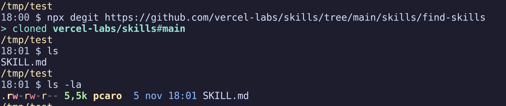

Title: degit: copy a repo without the history
Date: 2026-11-05 18:15
Category: Herramientas
Tags: git, degit, cli, nodejs
Slug: degit
Lang: en
featured_image: /images/degit.png
Summary: degit copies the latest version of a Git repo without downloading the history and without leaving a .git behind. Hand it a GitHub /tree/main/... URL and it takes just that folder.

I needed the `skills/find-skills` folder from the `vercel-labs/skills` repo, a single 5.5 KB `SKILL.md`. Cloning the whole repo for that makes no sense at all, so I reached for [degit](https://github.com/Rich-Harris/degit), Rich Harris' tool (the Svelte guy) that does exactly this: pull a repo down without dragging the history along.



And it takes the browser URL as is, `/tree/main/` and all.

## What it does

It resolves the ref, downloads the tarball for that commit and unpacks it. No history, and no `.git` left underneath.

It works with GitHub, GitLab, Bitbucket, Sourcehut and gists, and it's an npm package (Node 20 or later), so you can run it with `npx` without installing anything:

```bash
npx degit user/repo                  # latest version of the default branch
npx degit user/repo#v1.2.3           # tag, branch or commit
npx degit user/repo/subfolder        # just that folder
npx degit user/repo my-project       # into a new folder
npx degit user/repo my-project -F README.md,src   # just those files
```

The destination has to be empty unless you add `--force`. Tarballs are cached in `~/.cache/degit`, and with `--cache` it won't even ask the network. The 3.x line, which is what you get today, adds `-F`/`--files` to keep loose files, aliases for the repos you come back to (`degit alias github:user/repo myRepo`) and an interactive mode when you run it with no arguments. For private repos it falls back to `ssh`, and that path does need `git` on your `PATH`.

## Where it falls short

degit leaves you with a dead copy: no history, no remote, nothing to pull from. Perfect to start a project from a template, useless if you want to keep following the repo.

That's what `git sparse-checkout` is for, and it's still a real clone:

```bash
git clone --filter=blob:none --sparse https://github.com/user/repo
cd repo
git sparse-checkout set the/folder
```

Only that folder on disk, but with `pull`, branch switching and patches at hand. The difference between the two tools fits in one sentence: degit copies files, sparse-checkout brings you a repo with a narrower view.

*Fuente original*: [Rich-Harris/degit](https://github.com/Rich-Harris/degit)
