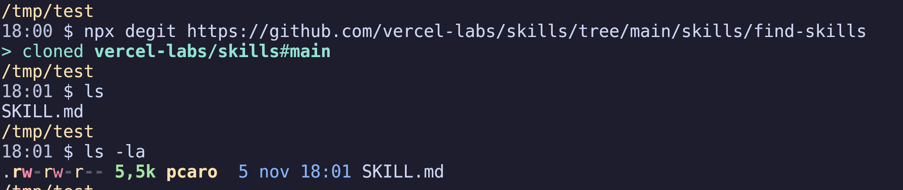

Title: degit: copiar un repo sin el historial
Date: 2026-11-05 18:15
Category: Herramientas
Tags: git, degit, cli, nodejs
Slug: degit
Lang: es
featured_image: /images/degit.png
Summary: degit copia la última versión de un repo de Git sin descargar el historial ni dejar un .git detrás. Si le pasas la URL /tree/main/... de GitHub, saca solo esa carpeta.

Necesitaba la carpeta `skills/find-skills` del repo `vercel-labs/skills`, un único `SKILL.md` de 5,5 KB. Clonar el repo entero para eso no tiene ningún sentido, así que tiré de [degit](https://github.com/Rich-Harris/degit), la herramienta de Rich Harris (el de Svelte) que hace exactamente esto: traerse un repo sin arrastrar el historial.



Y acepta la URL del navegador tal cual, con su `/tree/main/` y todo.

## Qué hace

Resuelve la referencia, se descarga el tarball de ese commit y lo descomprime. No hay historial y no deja un `.git` por debajo.

Funciona con GitHub, GitLab, Bitbucket, Sourcehut y gists, y es un paquete de npm (Node 20 o superior), así que se puede lanzar con `npx` sin instalar nada:

```bash
npx degit user/repo                  # última versión de la rama por defecto
npx degit user/repo#v1.2.3           # tag, rama o commit
npx degit user/repo/subcarpeta       # solo esa carpeta
npx degit user/repo mi-proyecto      # a una carpeta nueva
npx degit user/repo mi-proyecto -F README.md,src   # solo esos ficheros
```

El destino tiene que estar vacío salvo que añadas `--force`. Los tarballs se cachean en `~/.cache/degit`, y con `--cache` ni siquiera pregunta a la red. La 3.x, que es la que se instala hoy, añade `-F`/`--files` para quedarte con ficheros sueltos, alias para los repos que repites (`degit alias github:user/repo myRepo`) y un modo interactivo si lo lanzas sin argumentos. Para repos privados cae a `ssh`, y para eso sí hace falta `git` en el `PATH`.

## Dónde se queda corto

degit deja una copia muerta: sin historial, sin remote, sin nada de donde tirar. Perfecto para arrancar un proyecto desde una plantilla, inútil si quieres seguir el repo.

Para eso está `git sparse-checkout`, que sigue siendo un clon de verdad:

```bash
git clone --filter=blob:none --sparse https://github.com/user/repo
cd repo
git sparse-checkout set la/carpeta
```

Solo esa carpeta en el disco, pero con `pull`, cambio de rama y parches a mano. La diferencia entre las dos herramientas cabe en una frase: degit copia archivos, sparse-checkout trae un repo con una vista reducida.

*Fuente original*: [Rich-Harris/degit](https://github.com/Rich-Harris/degit)
