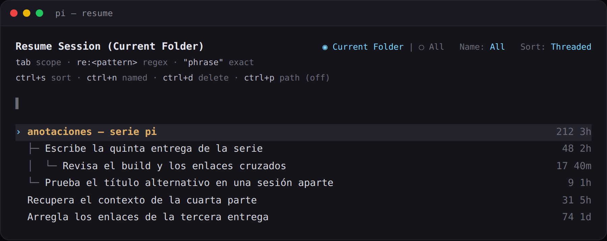
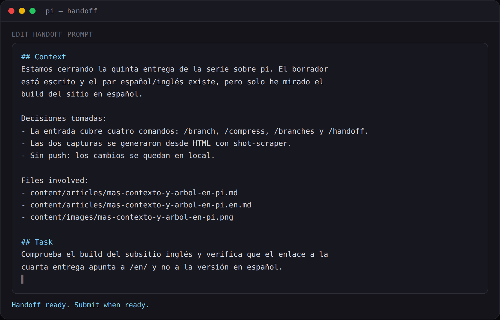

Fifth part of the series. The [fourth one](https://pablocaro.es/en/arboles-de-sesion-en-pi) covered what sits underneath the tree; this is what I have bolted on top. Four extension commands, three in `~/.pi/agent/extensions/branch.ts` and one in `handoff.ts`, and all of them run on the same API any pi extension gets: `ctx.navigateTree`, `ctx.newSession` and `generateBranchSummary`.

## /branch — jump back to the last branch point

It asks nothing. It waits for the agent to go idle, finds the last `branch_summary` on the active branch (or the root if there is none), summarizes what you are leaving and drops you right there.

```text
/branch  →  navigateTree(last branch_summary, summarize: true)
```

It is `/tree` without opening the session navigator and without picking the spot: the edge is decided by the last summarized branch. I use it to start a different attempt without dragging the implementation noise of the previous one. If you are already at that edge it says so and does nothing.

## /compress — close the session and open a new one with the summary

`/compact` summarizes inside the same file and the summary replaces the old messages in context. `/compress` does the same but starts a fresh session: the summary is the first message of a new file and the original stays where it was, ready to reopen with `pi -r` if you need it.

Before touching anything it tells you how much it is about to summarize, using the real context size, and then it calls `generateBranchSummary`, the same code pi uses when compacting. That brings output limits, retries, thinking level and the list of read and modified files without reimplementing any of it.

The new session is linked to the original through `parentSession`, which is what makes `pi -r` show it hanging under its parent:



The summary lands as its own message (`branch-compressed`), collapsed to one line and expandable, not as something I appear to have typed.

## /branches — which summarized branches the session is carrying

It lists the `branch_summary` entries on the active branch with a preview, estimated tokens (four characters per token) and the share of the context window they take. It is the detail behind the `🌿` status in the footer, which is recalculated on navigation and at the end of every turn.

The point is the usual one: when you chain a few `/end` without noticing, see how much context you are spending on summaries instead of on work.

## /handoff — turn the context into a prompt

`/handoff <goal>` is the one least related to the tree and the one I reach for most when the next piece is a different task. It rebuilds the branch respecting compactions — the compaction summary plus everything kept after it — and asks the model for a self-contained prompt with context, decisions, files touched and the task.

The result opens in the editor so you can fix it before sending:



Once you submit it, it creates the new session with `parentSession` and the prompt already in the editor. The difference with `/compress` is what each one takes with it: `/compress` takes a summary of what was done, `/handoff` hands you the map of what comes next.

## Which one I use

- **`/end`** — 90% of my tree usage, with the marker cycle from the fourth part.
- **`/compress`** — when the session is done: summary, new file, original intact.
- **`/branch`** — a different attempt inside the same session file.
- **`/handoff`** — the next thing is another task and I want distilled context, not history.

None of them is core: all four are my own extensions, which is why I can change the rules without waiting for a release. The tree gives you the pieces; what you build with them is yours.

*Source*: [pi extension docs](https://github.com/earendil-works/pi/tree/main/packages/coding-agent/docs/extensions.md) — `navigateTree`, `newSession` and `generateBranchSummary`.
