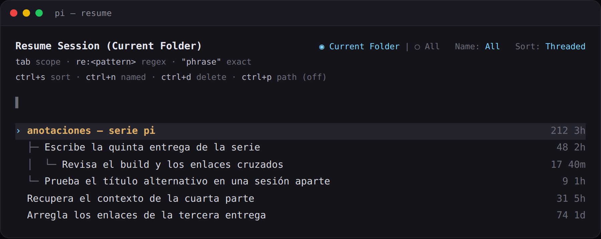
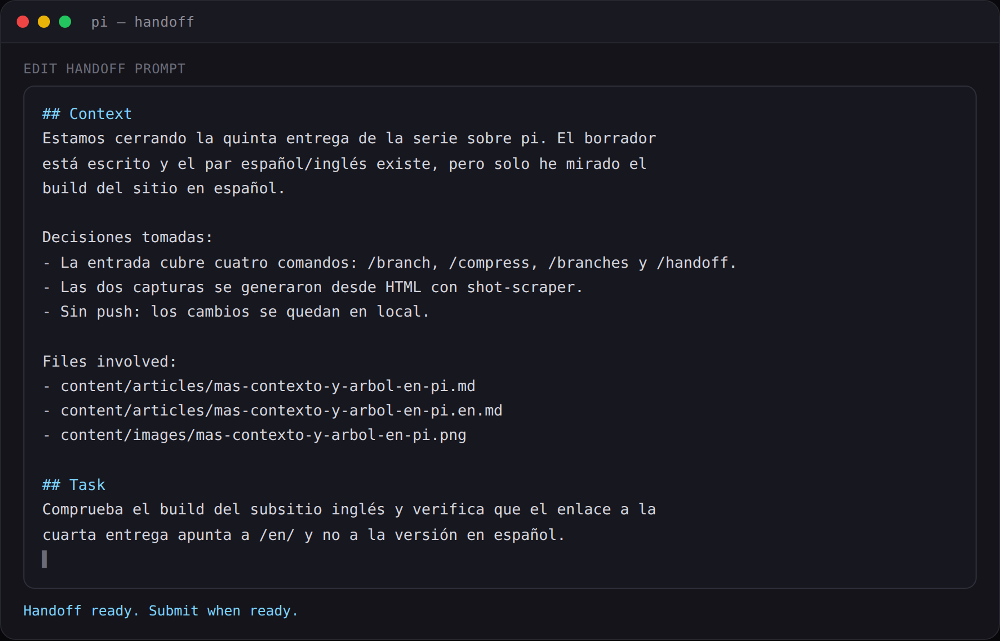

Quinta entrega de la serie. La [cuarta](https://pablocaro.es/arboles-de-sesion-en-pi) explicó qué hay debajo del árbol; esto es lo que le tengo puesto encima. Son cuatro comandos de extensión, tres en `~/.pi/agent/extensions/branch.ts` y uno en `handoff.ts`, y todos se resuelven con la misma API que cualquier extensión de pi: `ctx.navigateTree`, `ctx.newSession` y `generateBranchSummary`.

## /branch — volver al último punto de ramificación

No pregunta nada. Espera a que el agente esté quieto, busca el último `branch_summary` de la rama activa (o la raíz si no hay ninguno), resume lo que dejas atrás y te coloca justo ahí.

```text
/branch  →  navigateTree(última branch_summary, summarize: true)
```

Es `/tree` sin abrir el navegador de sesiones y sin elegir el punto: el borde lo decide la última rama resumida. Lo uso para empezar un intento distinto sin cargar con el ruido de implementación del anterior. Si ya estás en ese borde, avisa y no hace nada.

## /compress — cerrar la sesión y abrir otra con el resumen

`/compact` resume dentro del mismo fichero y el resumen pasa a sustituir lo viejo en el contexto. `/compress` hace lo mismo pero estrenando sesión: el resumen es el primer mensaje de un fichero nuevo y el original sigue donde estaba, listo para reabrir con `pi -r` si lo necesitas.

Antes de tocar nada te dice cuánto va a resumir, con el tamaño real de contexto, y luego tira de `generateBranchSummary`, el mismo código que usa pi al compactar. Eso le da los límites de salida, los reintentos, el thinking level y la lista de ficheros leídos y modificados sin reimplementar nada.

La sesión nueva queda enlazada a la original por `parentSession`, y eso es lo que hace que `pi -r` las enseñe colgando de su madre:



El resumen entra como mensaje propio (`branch-compressed`), colapsado a una línea y expandible, no como si lo hubiera escrito yo.

## /branches — qué ramas resumidas arrastra la sesión

Lista las entradas `branch_summary` de la rama activa con preview, tokens estimados (a cuatro caracteres por token) y el porcentaje de ventana que ocupan. Es el detalle de lo que el footer resume en el status `🌿`, que se recalcula al navegar y al terminar cada turno.

Sirve para lo de siempre: cuando encadenas varios `/end` sin darte cuenta, ver cuánto contexto te estás gastando en resúmenes en vez de en trabajo.

## /handoff — convertir el contexto en un prompt

`/handoff <objetivo>` es el que menos tiene que ver con el árbol y el que más me sirve cuando lo siguiente ya es otra cosa. Reconstruye la rama respetando compactaciones —el resumen de compactación más todo lo que quedó detrás— y le pide al modelo un prompt autocontenido con contexto, decisiones, ficheros tocados y la tarea.

El resultado se abre en el editor para corregirlo antes de enviarlo:



Al aprobarlo, crea la sesión nueva con `parentSession` y el prompt ya puesto en el editor. La diferencia con `/compress` es qué se llevan: `/compress` se lleva un resumen de lo hecho, `/handoff` te deja el mapa de lo que viene.

## Cuándo uso cada uno

- **`/end`** — el 90% de mi uso del árbol, con el ciclo de marker de la cuarta entrega.
- **`/compress`** — cuando la sesión ya cumplió: resumen, fichero nuevo, original intacta.
- **`/branch`** — un intento distinto dentro del mismo fichero de sesión.
- **`/handoff`** — lo siguiente es otra tarea y quiero contexto destilado, no historial.

Ninguno es core: los cuatro son extensiones mías, y por eso puedo cambiarles el criterio sin esperar a un release. El árbol de pi da las piezas; lo que haces con ellas es tuyo.

*Fuente original*: [documentación de extensiones de pi](https://github.com/earendil-works/pi/tree/main/packages/coding-agent/docs/extensions.md) — `navigateTree`, `newSession` y `generateBranchSummary`.
