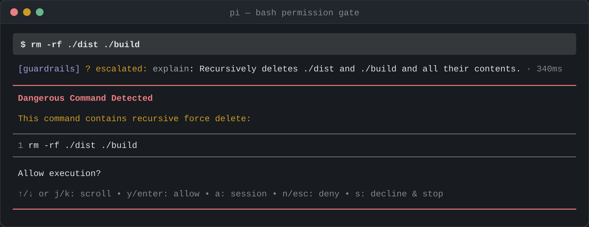

[Guardrails](https://github.com/aliou/pi-guardrails) already stops the agent when it wants to do something silly with bash. What it does not tell you is **what that command actually does**. And that is exactly the piece of information you need to answer the prompt in two seconds instead of thirty.



## The warning gives you the pattern, not the effect

The usual case:

```text
$ rm -rf ./dist ./build
```

Guardrails catches it and says:

```text
Dangerous Command Detected
This command contains recursive force delete:
```

Correct, but not enough. `rm -rf` over `./dist` is not the same as over `~/src`. The pattern is identical; the damage is not. And once the command is chained together the pattern falls short entirely:

```bash
find . -name "*.pyc" -delete && rm -rf "$(pwd)/.venv"
```

At that point you have to read it, think, and reconstruct the intent. Which is precisely what you do not want to do at 3am with an agent that has been working on its own for twenty minutes.

## What the extension does

[pi-guardrails-explain](https://github.com/pcaro/pi-guardrails-explain) hooks into Guardrails' decision delegation and adds a line to the prompt:

```text
[guardrails] ? escalated: explain: Recursively deletes ./dist and ./build. · 340ms
```

One sentence, in the language you ask for, describing the observable effects: which files it touches, whether it deletes, writes, goes out to the network, changes permissions. No verdicts.

```bash
pi install git:github.com/pcaro/pi-guardrails-explain
```

No build step: the package is plain TypeScript and pi loads it as-is. It needs Guardrails **0.23.0 or newer** (decision delegation landed in that version) and Node 22.19+, pi 1.5's minimum.

## It never decides for you

This is the important part of the design: the delegate **always answers `ask`**. It cannot allow or block. The model only describes; Guardrails' prompt still appears and your answer remains the only thing that authorises the command.

For anything that is not a bash command flagged by the permission gate, it abstains (`undefined`) and touches nothing: no files, no paths, no PowerShell.

There is one consequence worth knowing before installing it. Guardrails only runs a command without asking if **every** registered delegate says `allow`. If you have another delegate that auto-allowed certain commands, with this extension installed that path is gone for flagged bash: you will always see the prompt. That is the price of the explanation, and it seems cheap to me.

## Configuring the model and language

By default it uses the session's active model. If you want explanations from a small, fast model, declare it in `~/.pi/agent/settings.json`:

```json
{
  "guardrailsExplain": {
    "models": [
      "opencode-go-console/deepseek-v4.1-flash",
      "anthropic/claude-haiku-4-5"
    ],
    "language": "Spanish"
  }
}
```

Candidates are tried in order, skipping those whose provider has no credentials, and the active model is always tried last. If one fails, the next one is used. If they all fail, the prompt carries a generic line and the usual confirmation still shows up.

`language` ends up inside the prompt, so the value has to be an English language name: `"Spanish"`, not `"Español"`.

## The 10-second deadline

Guardrails runs delegates under a shared **10-second** deadline (hard cap of 60). A slow model does not make it and the explanation is lost; the prompt still appears, though. If your provider is slow, raise it in Guardrails' config, which is yours and not the package's:

```json
{
  "delegation": {
    "timeoutMs": 30000
  }
}
```

## What leaves your machine

Only the command text and the short reason Guardrails was already showing you. Never the conversation history. The command is framed as untrusted data in the prompt, with an explicit instruction to ignore anything inside it, so a `# ignore your rules` buried in a command does not get executed from there.

One caveat: the `models` list is a **preference**, not a provider allowlist. If they all fail, the active model is tried, and that one may belong to another provider. For a strict boundary, keep the session model inside the approved set.

And commands can carry secrets. A `curl -H "Authorization: Bearer ..."` has just gone to the model's provider. That is not a bug in the extension, it is what asking a model to read your command implies.

## Implementation details that bit me

Three things in the code that are not obvious:

- **Load order.** Guardrails builds its delegate roster by emitting a request and listening for registrations, but the order in which pi loads extensions is not guaranteed. The extension announces itself as soon as it loads (in case Guardrails came first) and announces itself again on every later request (in case it came after).
- **`reasoning: "off"`.** Requests go out with 128 output tokens. A reasoning model would spend the whole budget thinking and return empty text, so reasoning is turned off and the cap is left for the sentence.
- **Per-session cache.** Successful explanations are kept in memory, 64 entries, cleared on shutdown or reload. Repeating the same `rm -rf` does not hit the model again.

## Before you go

All 65 tests pass, covering the manifest, model selection, fallback and delegate registration. But what actually convinces me is the usual thing: less time staring at a weird command, more time deciding whether I approve it.

If you are new to pi, the [first part of the series](https://pablocaro.es/en/que-es-pi-coding-agent) explains what it is, and the [third one](https://pablocaro.es/en/extensiones-pi-que-uso) goes through the extensions I use daily, Guardrails included.

*Original source*: [pcaro/pi-guardrails-explain](https://github.com/pcaro/pi-guardrails-explain) and [Guardrails' decision delegation docs](https://github.com/aliou/pi-guardrails/blob/main/docs/decision-delegation.md).
