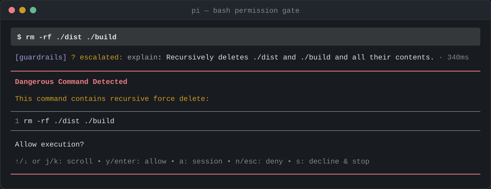

[Guardrails](https://github.com/aliou/pi-guardrails) ya te para cuando el agente quiere hacer algo tonto con bash. Lo que no te dice es **qué hace exactamente** ese comando. Y esa es justo la información que necesitas para responder al prompt en dos segundos en lugar de treinta.



## El aviso dice el patrón, no el efecto

El caso típico:

```text
$ rm -rf ./dist ./build
```

Guardrails lo detecta y te suelta:

```text
Dangerous Command Detected
This command contains recursive force delete:
```

Correcto, pero insuficiente. `rm -rf` no es lo mismo sobre `./dist` que sobre `~/src`. El patrón es idéntico; el destrozo, no. Y cuando el comando viene encadenado el patrón se queda corto del todo:

```bash
find . -name "*.pyc" -delete && rm -rf "$(pwd)/.venv"
```

Ahí ya toca leer, pensar y reconstruir la intención. Que es exactamente lo que uno no quiere hacer a las tres de la mañana con un agente que lleva veinte minutos trabajando solo.

## Lo que hace la extensión

[pi-guardrails-explain](https://github.com/pcaro/pi-guardrails-explain) se engancha a la delegación de decisiones de Guardrails y añade una línea al aviso:

```text
[guardrails] ? escalated: explain: Recursively deletes ./dist and ./build. · 340ms
```

Una frase, en el idioma que le pidas, describiendo los efectos observables: qué ficheros toca, si borra, si escribe, si sale a la red, si cambia permisos. Nada de veredictos.

```bash
pi install git:github.com/pcaro/pi-guardrails-explain
```

Sin paso de build: el paquete es TypeScript plano y pi lo carga tal cual. Hace falta Guardrails **0.23.0 o superior** (la delegación de decisiones llegó en esa versión) y Node 22.19+, el mínimo que pide pi 1.5.

## Nunca decide por ti

Esto es lo importante del diseño: el delegado **siempre responde `ask`**. No puede permitir ni bloquear. El modelo solo describe; el prompt de Guardrails sale igual y tu respuesta sigue siendo lo único que autoriza el comando.

Para lo que no es un comando de bash marcado por el permission gate, se abstiene (`undefined`) y no toca nada: ni ficheros, ni rutas, ni PowerShell.

Hay una consecuencia que conviene tener clara antes de instalarlo. Guardrails solo ejecuta sin preguntar si **todos** los delegados registrados dicen `allow`. Si tienes otro delegado que auto-permitía ciertos comandos, con esta extensión instalada ese camino desaparece para el bash marcado: siempre verás el prompt. Es el precio de tener la explicación, y a mí me parece barato.

## Configurar modelo e idioma

Por defecto usa el modelo activo de la sesión. Si quieres que las explicaciones las haga un modelo pequeño y rápido, se declara en `~/.pi/agent/settings.json`:

```json
{
  "guardrailsExplain": {
    "models": [
      "opencode-go-console/deepseek-v4.1-flash",
      "anthropic/claude-haiku-4-5"
    ],
    "language": "Spanish"
  }
}
```

Los candidatos se prueban en orden, saltando los que tengan el proveedor sin credenciales, y el modelo activo se prueba siempre al final. Si uno falla, se pasa al siguiente. Si fallan todos, el aviso lleva un texto genérico y el prompt de siempre.

`language` acaba dentro del prompt, así que el valor tiene que ser un nombre de idioma en inglés: `"Spanish"`, no `"Español"`.

## El plazo de 10 segundos

Guardrails ejecuta los delegados con un plazo compartido de **10 segundos** (tope duro de 60). Un modelo lento no llega y la explicación se pierde; el prompt sale igual, eso sí. Si tu proveedor tarda, se sube en la config de Guardrails, que es tuya y no del paquete:

```json
{
  "delegation": {
    "timeoutMs": 30000
  }
}
```

## Qué sale de tu máquina

Solo el texto del comando y la razón corta que ya te estaba mostrando Guardrails. Nunca el historial de la conversación. El comando va etiquetado como dato no confiable en el prompt, con instrucción explícita de ignorar lo que venga dentro, así que un `# ignora tus reglas` metido en un comando no se ejecuta desde ahí.

Ojo con una cosa: la lista de `models` es una **preferencia**, no una lista blanca de proveedores. Si todos fallan, se prueba el modelo activo, y ese puede ser de otro proveedor. Si quieres una frontera estricta, mantén el modelo de la sesión dentro del conjunto aprobado.

Y los comandos pueden llevar secretos dentro. Un `curl -H "Authorization: Bearer ..."` acaba de irse al proveedor del modelo. No es un fallo de la extensión, es lo que implica pedirle a un modelo que te lea el comando.

## Detalles de implementación que me costaron

Tres cosas del código que no son obvias:

- **Orden de carga.** Guardrails construye su plantilla de delegados emitiendo una petición y escuchando registros, pero el orden en que pi carga las extensiones no está garantizado. La extensión se anuncia nada más cargar (por si Guardrails llegó antes) y vuelve a anunciarse en cada petición posterior (por si llegó después).
- **`reasoning: "off"`.** Las peticiones van con 128 tokens de salida. Un modelo con razonamiento se gastaría el presupuesto entero pensando y devolvería texto vacío, así que el razonamiento va apagado y el tope se queda para la frase.
- **Caché por sesión.** Las explicaciones acertadas se guardan en memoria, 64 entradas, y se limpian al cerrar o recargar. Repetir el mismo `rm -rf` no vuelve a llamar al modelo.

## Antes de irte

Los tests pasan los 65, entre manifiesto, selección de modelos, fallback y el registro del delegado. Pero lo que de verdad me convence es lo de siempre: menos tiempo mirando un comando raro, más tiempo decidiendo si lo apruebo.

Si vienes de cero con pi, la [primera parte de la serie](https://pablocaro.es/que-es-pi-coding-agent) explica qué es y en la [tercera](https://pablocaro.es/extensiones-pi-que-uso) repaso las extensiones que uso a diario, Guardrails incluido.

*Fuente original*: [pcaro/pi-guardrails-explain](https://github.com/pcaro/pi-guardrails-explain) y la [documentación de delegación de decisiones de Guardrails](https://github.com/aliou/pi-guardrails/blob/main/docs/decision-delegation.md).
