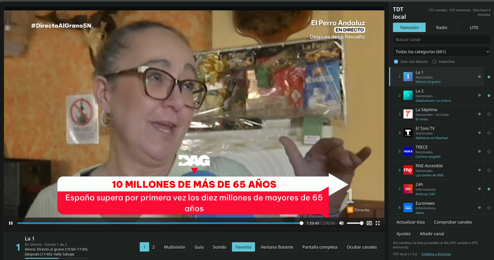

Title: Spanish DTT in the NAS: a Docker image for tdt-local
Date: 2026-11-05 12:00
Category: Herramientas
Tags: docker, unraid, tdt, nas, homelab, linux
Slug: tdt-local-docker
Lang: en
featured_image: /images/tdt-local-docker.png
Summary: tdt-local ships no Docker, so I built an image for it: it downloads the release, verifies it with SHA-256 and starts it listening on the LAN. Here's what's inside, the Unraid template, and the trap around settings you can't save.

The TV can be a browser tab. [tdt-local](https://github.com/cibernicola/tdt-local) handles the hard part (the HLS live streams of Spanish DTT and radio, with EPG and multiview), but the project publishes no Docker.
So I wrote the wrapper and left it running on the NAS.



There it is: 772 channels and 975 radio stations read from the [TDTChannels](https://github.com/LaQuay/TDTChannels) lists, La 1 live and everything else one click away.

## What tdt-local is

A local web viewer for Spanish DTT. It plays the HLS streams through a proxy of its own, brings EPG data, builds a four-channel multiview with rotating audio and keeps the last seven days of RTVE (U7D). It transcodes nothing: it just forwards what the broadcasters already serve, so any CPU will do.

What it doesn't ship is a `Dockerfile` or a published image. That's where [this repo](https://github.com/pcaro/tdt-local-docker) comes in.

## What's inside the image

The `Dockerfile` is forty lines: `python:3.12-slim`, the source code of whichever release, `pip install .` and off you go.

```dockerfile
ARG TDT_VERSION=1.3.0
ARG TDT_SHA256=dc3f2bc7eb25d35919b572e7b2072cbf8082b062c3d80d5a4f1828f36bdf6862

ADD https://github.com/cibernicola/tdt-local/archive/refs/tags/v${TDT_VERSION}.tar.gz /tmp/tdt-local.tar.gz
RUN echo "${TDT_SHA256}  /tmp/tdt-local.tar.gz" | sha256sum -c - && \
    tar -xzf /tmp/tdt-local.tar.gz --strip-components=1 && \
    pip install --no-cache-dir .
```

The version is pinned and the `sha256sum -c` is not optional: if the tarball GitHub serves doesn't match, the build dies. This image ends up in anyone's `docker pull`, and I don't want its contents to depend on some third party keeping the same file forever.

`ffmpeg` is included because the subtitles and the SCTE-35 ad markers need it. That's about 450 MB of image: with `--build-arg WITH_FFMPEG=0` it drops to roughly 120 MB, at the cost of losing those two features.

The GitHub Action builds `linux/amd64` and `linux/arm64` with buildx and pushes to GHCR under the version tag and `latest`. The same image works on an x86 NAS and on a Raspberry.

## Running it

```bash
docker run -d --name tdt-local -p 8788:8788 -v "$PWD/data:/data" \
  -e TDT_AI_ENABLED=0 -e TDT_STT_ENABLED=0 --restart unless-stopped \
  ghcr.io/pcaro/tdt-local-docker:latest
```

Then open <http://NAS-IP:8788/>. The first run needs internet to fetch the lists; after that it uses the copy kept in the volume. With Compose, the `compose.yaml` in the repo is ready to go.

## Unraid: the template and its traps

The NAS runs Unraid, so besides the `Dockerfile` I left a template. Over SSH or with the **>_** button in the UI:

```bash
curl -fsSL -o /boot/config/plugins/dockerMan/templates-user/my-tdt-local.xml \
  https://raw.githubusercontent.com/pcaro/tdt-local-docker/main/unraid/tdt-local.xml
```

Then **Docker** → *Add Container* → pick **tdt-local** under *Template*, check the port and the folder, and hit **Apply**.

Two things I wasted time learning:

- The **Template URL** field on that screen downloads nothing. In Unraid's source it sits inside a `noshow` block: it's metadata for the template author, not an import button.
- **Post Arguments** must stay empty. Whatever you type there replaces the image's `CMD`, and the container starts and dies without saying why.

## The big one: you can't save settings

The settings screen always answers this:

```text
POST /api/settings → 403 {"error": "los ajustes solo se pueden cambiar desde el propio equipo"}
```

It's not a container bug. The program only accepts settings writes when the request comes from `127.0.0.1`, and from Docker the request arrives with the bridge IP.
Three ways to live with it, from least to most annoying:

1. **Environment variables**, which is the normal path. Any setting on that screen can be pinned with `TDT_<SETTING_NAME_UPPERCASED>`, and once pinned the UI shows it read-only: `TDT_UPDATE_HOURS=12`, `TDT_EPG_ENABLED=0`, `TDT_AUTO_CHECK=1`, `TDT_LLM_URL=http://192.168.1.10:8080/v1`, `TDT_LLM_API_KEY=…` (that way the key never lands in `settings.json`).
2. **`docker exec`**, for a one-off change, because inside the container `127.0.0.1` really is loopback.
3. **SSH tunnel with host networking**: `network_mode: host` in the compose file and then `ssh -L 8788:127.0.0.1:8788 root@your-nas`. With `bridge` networking the tunnel is useless.

The second option, concretely, looks like this:

```bash
docker exec tdt-local python -c "import urllib.request as u, json; \
  r=u.Request('http://127.0.0.1:8788/api/settings', data=json.dumps({'update_hours':12}).encode(), \
  headers={'Content-Type':'application/json'}); print(u.urlopen(r).read().decode())"
```

Reading settings, refreshing the lists, checking channels and adding your own channels all work fine; the only blocked thing is saving from the web UI.

## What it doesn't ship, and what to keep in mind

- **The AI assistant and subtitles are off** (`TDT_AI_ENABLED=0`, `TDT_STT_ENABLED=0`). They need `llama.cpp` and `whisper-server`, which are separate programs and want real CPU and RAM. If you have an AI server on the network, point `TDT_LLM_URL` at it and flip the variable.
- **No authentication.** The author says it himself and I'll repeat it: LAN or VPN, never behind a public reverse proxy.
- **All the video goes through the NAS.** It doesn't transcode, but each channel costs twice its bitrate on the network card: a four-channel multiview at 6 Mbps is about 48 Mbps.
- Data lives in the `/data` volume: lists, EPG, your own channels and settings. That's what to copy if you want a backup.

## I vibe-coded it, and you can tell

I don't write Unraid templates every day. But as we know, that's no longer needed.
The Unraid template was generated by pi-agent and **worked first try** on the NAS: the XML, the icon, the port and the folder, all in place and the container up without touching a thing.

What didn't work first try was everything else, and that's where vibe coding falls short if you're not the one driving: the 403 on settings, the *Template URL* field that downloads nothing, the *Post Arguments* that eats the `CMD`, the port published on `127.0.0.1` that changes nothing.

The conclusion I take from it: the code is the cheap part. The expensive part is knowing what needs verifying and not trusting that it "should work".

## Wrap-up

Spanish DTT fits in a 580 MB container, with no transcoding and nothing exposed to the internet. The original project does all the work; my part is a wrapper, an Unraid template and a README that is basically a log of my stumbles. If you run Unraid and miss having TV in the browser, it takes two minutes.

*Fuente original*: [tdt-local](https://github.com/cibernicola/tdt-local), [TDTChannels](https://github.com/LaQuay/TDTChannels) and [tdt-local-docker](https://github.com/pcaro/tdt-local-docker).
