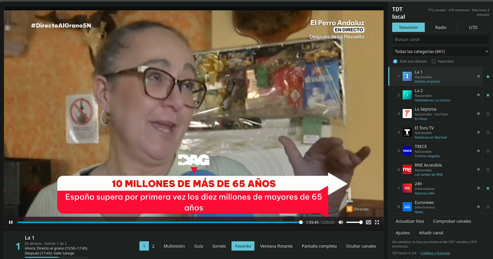

Title: La TDT española en el NAS: imagen Docker de tdt-local
Date: 2026-11-05 12:00
Category: Herramientas
Tags: docker, unraid, tdt, nas, homelab, linux
Slug: tdt-local-docker
Lang: es
featured_image: /images/tdt-local-docker.png
Summary: tdt-local no publica Docker, así que me hice una imagen: baja su release, lo comprueba con SHA-256 y lo arranca escuchando en la red local. Esto es lo que hay dentro, la plantilla de Unraid y la trampa de los ajustes que no se pueden guardar.

La tele puede ser una pestaña del navegador. [tdt-local](https://github.com/cibernicola/tdt-local) resuelve la parte difícil (los directos HLS de la TDT y la radio, con guía de programación y multivisión), pero el proyecto no publica Docker.
Así que escribí el envoltorio y lo dejé corriendo en el NAS.



Ahí está el resultado: 772 canales y 975 emisoras leídos de las listas de [TDTChannels](https://github.com/LaQuay/TDTChannels), La 1 en directo y el resto a un clic.

## Qué es tdt-local

Un visor web local para la TDT española. Reproduce los directos HLS a través de un proxy propio, trae EPG, monta una multivisión de cuatro canales con audio rotativo y guarda los últimos siete días de RTVE (U7D). No transcodifica nada: solo reenvía lo que ya emiten las cadenas, así que cualquier CPU sirve.

Lo que no trae es `Dockerfile` ni imagen publicada. Y ahí es donde entra [este repo](https://github.com/pcaro/tdt-local-docker).

## Cómo está hecha la imagen

El `Dockerfile` son cuarenta líneas: `python:3.12-slim`, el código fuente del release que toque, `pip install .` y a correr.

```dockerfile
ARG TDT_VERSION=1.3.0
ARG TDT_SHA256=dc3f2bc7eb25d35919b572e7b2072cbf8082b062c3d80d5a4f1828f36bdf6862

ADD https://github.com/cibernicola/tdt-local/archive/refs/tags/v${TDT_VERSION}.tar.gz /tmp/tdt-local.tar.gz
RUN echo "${TDT_SHA256}  /tmp/tdt-local.tar.gz" | sha256sum -c - && \
    tar -xzf /tmp/tdt-local.tar.gz --strip-components=1 && \
    pip install --no-cache-dir .
```

La versión está fijada y el `sha256sum -c` es obligatorio: si el tarball que sirve GitHub no coincide, el build muere. Es una imagen que va a acabar en un `docker pull` de cualquiera, y no me apetece que un día el contenido dependa de que el archivo de un tercero siga siendo el mismo.

`ffmpeg` viene incluido porque lo necesitan los subtítulos y las marcas de publicidad SCTE-35. Son unos 450 MB de imagen: con `--build-arg WITH_FFMPEG=0` se queda en unos 120 MB, a cambio de perder esas dos funciones.

La Action de GitHub construye `linux/amd64` y `linux/arm64` con buildx y publica en GHCR la etiqueta de la versión y `latest`. Así la misma imagen vale para un NAS x86 y para una Raspberry.

## Arrancarla

```bash
docker run -d --name tdt-local -p 8788:8788 -v "$PWD/data:/data" \
  -e TDT_AI_ENABLED=0 -e TDT_STT_ENABLED=0 --restart unless-stopped \
  ghcr.io/pcaro/tdt-local-docker:latest
```

Y en <http://IP-del-NAS:8788/>. La primera vez necesita internet para bajar las listas; después tira de la copia que guarda en el volumen. Con Compose, el `compose.yaml` del repo ya viene listo.

## Unraid: la plantilla y sus trampas

El NAS es Unraid, así que además del `Dockerfile` dejé una plantilla. Por SSH o con el botón **>_** de la interfaz:

```bash
curl -fsSL -o /boot/config/plugins/dockerMan/templates-user/my-tdt-local.xml \
  https://raw.githubusercontent.com/pcaro/tdt-local-docker/main/unraid/tdt-local.xml
```

Después **Docker** → *Add Container* → en *Template* eliges **tdt-local**, revisas el puerto y la carpeta, y **Apply**.

Dos cosas que perdí tiempo aprendiendo:

- El campo **Template URL** de esa pantalla no descarga nada. En el código de Unraid está dentro de un bloque `noshow`: es metadato para el autor de la plantilla, no un botón de importar.
- **Post Arguments** tiene que quedar vacío. Lo que escribas ahí sustituye al `CMD` de la imagen, y el contenedor arranca y muere sin decir por qué.

## La trampa gorda: los ajustes no se pueden guardar

La pantalla «Ajustes» da siempre este error:

```text
POST /api/settings → 403 {"error": "los ajustes solo se pueden cambiar desde el propio equipo"}
```

No es un fallo del contenedor. El programa solo acepta escribir ajustes si la petición viene de `127.0.0.1`, y desde Docker la petición llega con la IP del bridge.
Tres formas de vivir con ello, de menos a más incómoda:

1. **Variables de entorno**, que es lo normal. Cualquier ajuste de esa pantalla se fija con `TDT_<NOMBRE_EN_MAYÚSCULAS>`, y al estar fijado la interfaz lo muestra en solo lectura: `TDT_UPDATE_HOURS=12`, `TDT_EPG_ENABLED=0`, `TDT_AUTO_CHECK=1`, `TDT_LLM_URL=http://192.168.1.10:8080/v1`, `TDT_LLM_API_KEY=…` (así la clave no acaba en `settings.json`).
2. **`docker exec`**, para un cambio puntual, porque dentro del contenedor `127.0.0.1` sí es loopback.
3. **Túnel SSH con red host**: `network_mode: host` en el compose y luego `ssh -L 8788:127.0.0.1:8788 root@tu-nas`. Con red `bridge` el túnel no sirve de nada.

La segunda opción, en concreto, se ve así:

```bash
docker exec tdt-local python -c "import urllib.request as u, json; \
  r=u.Request('http://127.0.0.1:8788/api/settings', data=json.dumps({'update_hours':12}).encode(), \
  headers={'Content-Type':'application/json'}); print(u.urlopen(r).read().decode())"
```

Leer ajustes, refrescar listas, comprobar canales y añadir canales propios funciona sin problema; lo único bloqueado es guardar desde la web.

## Lo que no trae y lo que conviene saber

- **Asistente de IA y subtítulos van apagados** (`TDT_AI_ENABLED=0`, `TDT_STT_ENABLED=0`). Necesitan `llama.cpp` y `whisper-server`, que son programas aparte y piden CPU y RAM de verdad. Si tienes un servidor de IA en la red, apunta `TDT_LLM_URL` a él y activa la variable.
- **Sin autenticación.** Lo dice el propio autor y lo repito: LAN o VPN, nunca detrás de un proxy público.
- **Todo el vídeo pasa por el NAS.** No transcodifica, pero cada canal consume el doble de su bitrate en la tarjeta de red: una multivisión de cuatro canales a 6 Mbps son unos 48 Mbps.
- Los datos viven en el volumen `/data`: listas, guía, canales propios y ajustes. Eso es lo que hay que copiar si quieres respaldar.

## Lo escribí vibecodeando, y se nota

No escribo templates de unraid todos los días. Pero como sabemos, eso ya no hace falta.
La plantilla de Unraid la generó pi-agent y **funcionó a la primera** en el NAS: el XML, el icono, el puerto y la carpeta, todo en su sitio y el contenedor arriba sin tocar nada.

Lo que no salió a la primera fue todo lo demás, y ahí es donde el vibecoding se queda corto si no lo llevas tú: el 403 de los ajustes, el campo *Template URL* que no descarga nada, el *Post Arguments* que se come el `CMD`, el puerto publicado en `127.0.0.1` que no cambia nada.

La conclusión que saco: el código es la parte barata. Lo caro es saber qué hay que verificar y no fiarse de que "debería funcionar".

## Conclusión

La TDT española cabe en un contenedor de 580 MB, sin transcodificar y sin abrir nada a Internet. El proyecto original hace todo el trabajo; mi parte es un envoltorio, una plantilla de Unraid y un README que es básicamente el registro de mis tropiezos. Si tienes Unraid y echas de menos la tele en el navegador, son dos minutos.

*Fuente original*: [tdt-local](https://github.com/cibernicola/tdt-local), [TDTChannels](https://github.com/LaQuay/TDTChannels) y [tdt-local-docker](https://github.com/pcaro/tdt-local-docker).
