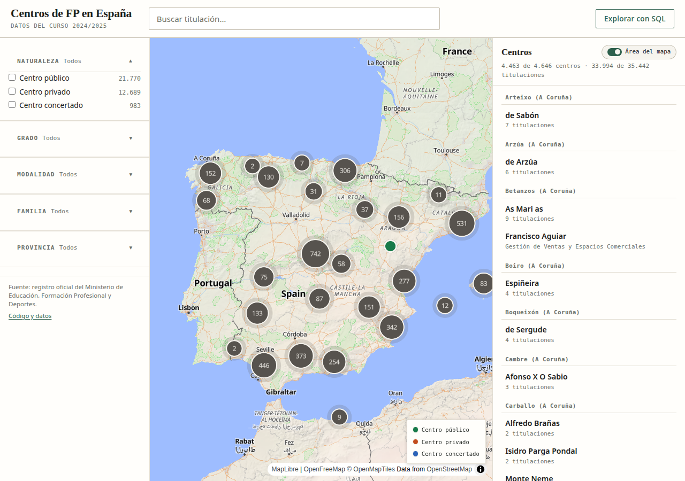

After all those years at CARTO I never lost the itch to make little maps. And the occasion showed up at home: my kids are in 10th grade and already facing their first serious decision —vocational training (FP) or the academic track (Bachillerato)—.

Everything is in [todofp.es](https://todofp.es): the qualifications, the data, the centers. What's missing for this case is a **proximity search**: which centers offer the program I care about near where I live? The official search can't answer that, so I got to work.

- Code: [pcaro/todo-fp-map](https://github.com/pcaro/todo-fp-map)
- The site: [pcaro.github.io/todo-fp-map](https://pcaro.github.io/todo-fp-map/)



## What's inside

I scraped the Spanish Ministry of Education's center registry (2024/2025 school year) and poured it into a SQLite database: **4,646 geocoded FP centers** and **292 distinct qualifications**, 35,442 offer rows in the map view. Geocoding doesn't depend solely on OpenStreetMap: an official Andalusian directory CSV plus **CartoCiudad**, reaching 92.8% coordinate coverage over the full registry.

The script handles the whole pipeline and only needs [uv](https://docs.astral.sh/uv/):

```bash
uv sync
uv run todofp fetch --ccaa "" --concurrencia 6   # 1 + 35,310 requests, ~17 min
uv run todofp geocode --ccaa "" --concurrencia 6 # Andalusian CSV + CartoCiudad, ~1.5 h
uv run todofp mapa                               # map and oferta_mapa tables (FP only)
```

## The part I wanted to do differently

Browsers are so capable these days, why build a backend at all? The database goes **straight to the browser**: the static page downloads the gzipped SQLite file (1.02 MB), opens it with **SQLite compiled to WebAssembly (sql.js)** inside a Web Worker, and all filtering and faceting runs locally against the same SQL views Datasette uses. Cold load in one second, no install, nothing behind it but GitHub Pages.

It's the same instinct as [QEMU booting inside a tab](https://pablocaro.es/en/qemu-wasm-maquinas-virtuales-en-el-navegador): if the runtime already lives in the client, the server is redundant.

What you can do with it:

- **Qualification search** with typeahead over the 292, plus facets with counts (grade, family, province, ownership, modality) that instantly recompute map and list.
- **MapLibre map** with OpenFreeMap: counted clusters, popups with the center's data, and a full card (address, phone, website, programs by grade).
- **List** synced with the filters, restrictable to the current map bounds.
- **Explore with SQL**: the same db in Datasette Lite with the active filters preloaded, for anyone who wants free-form queries.
- Every view is a **shareable link**, because the state (qualification, facets, and viewport) lives in the URL.

## Why I wanted it

The real question was never "which centers exist in Spain?" but "where can you study *Web Application Development* without moving away from home?". Now it's typing the program, looking at the clusters nearby, and clicking. Whenever one of the two makes up their mind, I already have the map.

*Original source*: [pcaro/todo-fp-map](https://github.com/pcaro/todo-fp-map) and [pcaro.github.io/todo-fp-map](https://pcaro.github.io/todo-fp-map/).
