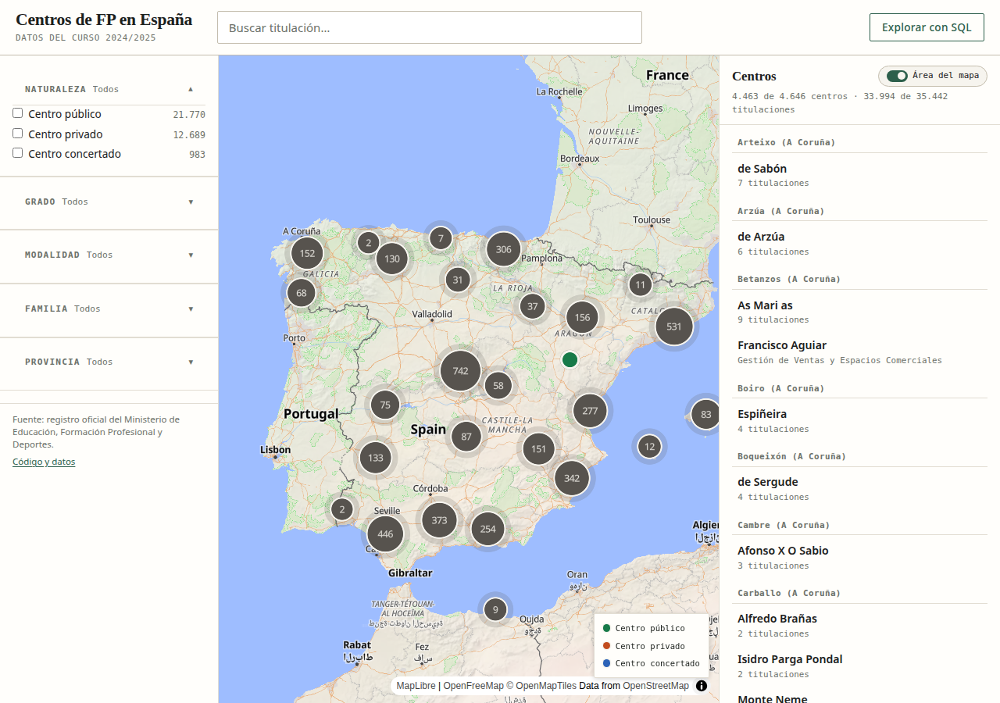

Después de tantos años en CARTO no se me han pasado las ganas de crear mapitas. Y la ocasión ha surgido en casa: mis niños están en 4º de ESO y ya tienen delante la primera decisión seria de sus carreras —FP o Bachillerato—.

En [todofp.es](https://todofp.es) está todo: las titulaciones, los datos, los centros. Lo que se echa de menos para este caso es una **búsqueda por cercanía**: ¿qué centros imparten el ciclo que me interesa cerca de donde vivo? El buscador oficial no responde a eso, así que manos a la obra.

- Código: [pcaro/todo-fp-map](https://github.com/pcaro/todo-fp-map)
- La web: [pcaro.github.io/todo-fp-map](https://pcaro.github.io/todo-fp-map/)



## Qué hay dentro

He scrapeado el buscador de centros del Ministerio de Educación y Formación Profesional (curso 2024/2025) y lo he volcado en una base SQLite: **4.646 centros de FP geolocalizados** y **292 titulaciones distintas**, 35.442 filas de oferta en la vista del mapa. La geocodificación no depende solo de OpenStreetMap: CSV oficial del directorio andaluz y **CartoCiudad**, con un 92,8 % de cobertura de coordenadas sobre el registro completo.

El script hace todo el ciclo y solo necesita [uv](https://docs.astral.sh/uv/):

```bash
uv sync
uv run todofp fetch --ccaa "" --concurrencia 6   # 1 + 35.310 peticiones, ~17 min
uv run todofp geocode --ccaa "" --concurrencia 6 # CSV andaluz + CartoCiudad, ~1,5 h
uv run todofp mapa                               # tablas mapa y oferta_mapa (solo FP)
```

## La parte que quería hacer distinta

Con lo potentes que son hoy los navegadores, ¿para qué montar un backend? La base de datos va **directamente al browser**: la página estática baja la SQLite comprimida (1,02 MB gzip), la abre con **SQLite compilado a WebAssembly (sql.js)** dentro de un Web Worker, y todo el filtrado y las facetas corren en local, contra las mismas vistas SQL que usa Datasette. Carga en frío en un segundo, sin instalación y sin nada detrás más que GitHub Pages.

Es el mismo instinto de [QEMU arrancando dentro de una pestaña](https://pablocaro.es/qemu-wasm-maquinas-virtuales-en-el-navegador): si el runtime ya está en el cliente, el servidor sobra.

Lo que se puede hacer:

- **Buscador de titulación** con typeahead sobre las 292, y facetas con conteos (grado, familia, provincia, naturaleza, modalidad) que recalculan mapa y lista al momento.
- **Mapa** MapLibre con OpenFreeMap: clusters con conteo, popup con los datos del centro y ficha completa (dirección, teléfono, web, enseñanzas por grado).
- **Lista** sincronizada con los filtros, limitable al encuadre del mapa.
- **Explorar con SQL**: la misma db en Datasette Lite con los filtros activos ya puestos, para quien quiera consultas libres.
- Cualquier vista es un **enlace compartible**, porque el estado (titulación, facetas y encuadre) vive en la URL.

## Para qué lo quería

La pregunta real no era "¿qué centros hay en España?" sino "¿dónde se estudia *Desarrollo de Aplicaciones Web* sin mudarse de casa?". Ahora es escribir la titulación, mirar los clusters alrededor y pinchar. En un año que decida alguno de los dos, ya tengo el mapa.

*Fuente original*: [pcaro/todo-fp-map](https://github.com/pcaro/todo-fp-map) y [pcaro.github.io/todo-fp-map](https://pcaro.github.io/todo-fp-map/).
